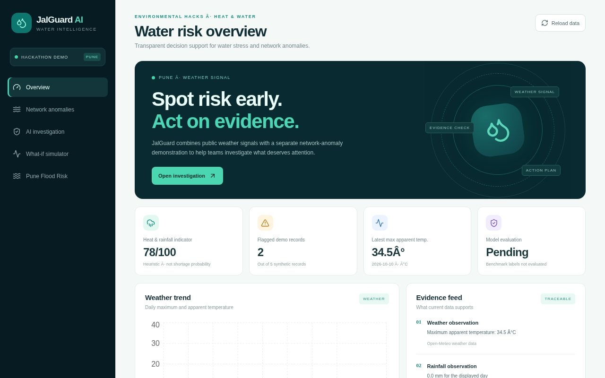
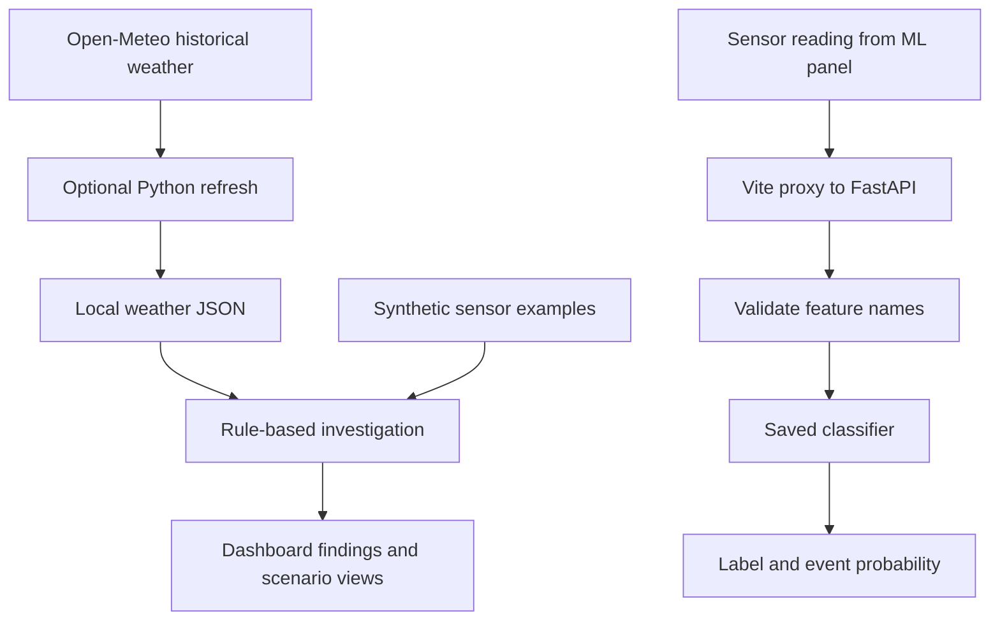
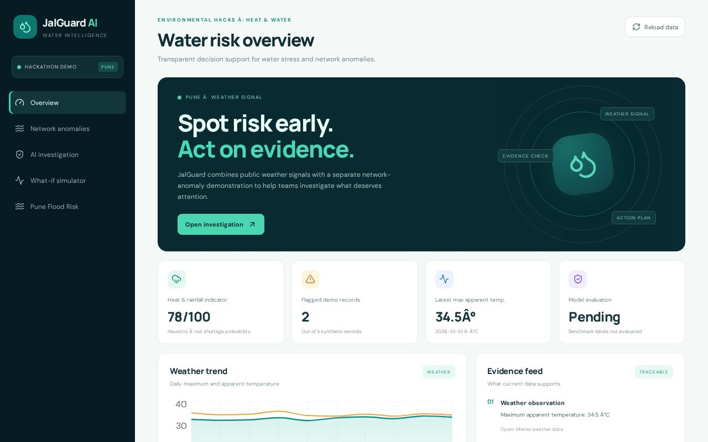

# JalGuard AI

Explore how weather and water-network sensor readings can help an analyst investigate a possible anomaly. The React dashboard pairs a Pune weather view with synthetic sensor scenarios. A separate FastAPI service scores a supplied sensor reading using an experimental classifier.

[Open the live dashboard on AWS Amplify](https://main.d3tvq4hm8oszdm.amplifyapp.com/)

## Local preview



The dashboard loaded its bundled weather and demonstration sensor data in a local Chromium session.

## Problem and goal

A hot day, a change in flow and an unusual pressure reading each tell a different story. JalGuard puts these signals in one dashboard so a reviewer can inspect the evidence behind a warning and explore a what-if scenario. It uses Pune weather and illustrative sensor records. The experimental classifier is a separate path for scoring a supplied sensor reading.

## Workflow



## Languages, tools and APIs

| Component | Role |
| --- | --- |
| JavaScript / JSX, React, Vite and CSS | Dashboard navigation, state and development server |
| Recharts, Leaflet and React Leaflet | Weather charts and interactive geographic views. Map tiles come from OpenStreetMap. |
| Python, Requests and Open-Meteo | The [weather script](scripts/fetch_weather.py) calls the historical archive for maximum temperature, apparent temperature and rainfall. It writes the response to a local JSON file. |
| FastAPI, Pydantic, pandas, scikit-learn and joblib | Validate input, arrange sensor features in training order and score one reading |
| Local API | `GET /` reports model metadata. `GET /health` reports whether the model loaded. `POST /predict` accepts a JSON object with a `readings` dictionary. Missing or unexpected features return HTTP 422. |

## Explore the project

| Start here | What to look for |
| --- | --- |
| [Investigation logic](frontend/src/investigationEngine.js) | How the dashboard assembles evidence for a scenario |
| [Pune map](frontend/src/PuneFloodMap.jsx) | The geographic view used in the dashboard |
| [Prediction API](api.py) | Feature validation, model inference and the event probability returned to the caller |
| [Holdout results](baseline_file_holdout_results.csv) | Recorded evaluation results for the baseline experiment |

## Run on Windows with PowerShell

Use Node.js 22.12 or later in the 22.x line and Python 3.10 or later. From a folder where you keep projects:

```powershell
git clone https://github.com/Ashishkumar401/JalGuard-AI.git
Set-Location .\JalGuard-AI
Set-Location .\frontend
npm.cmd ci --legacy-peer-deps
npm.cmd run dev
```

Open the local address printed by Vite, normally `http://localhost:5173`. The dashboard loads its bundled JSON files on startup. To use the experimental ML panel, open a second PowerShell window **in the repository root**:

```powershell
py -3 -m venv .venv
.\.venv\Scripts\python.exe -m pip install -r requirements.txt fastapi uvicorn joblib
.\.venv\Scripts\python.exe -m uvicorn api:app --host 127.0.0.1 --port 8000
```

Check the API with `Invoke-RestMethod http://127.0.0.1:8000/health`. The frontend sends `POST /api-ml/predict`. The Vite dev proxy strips `/api-ml` and forwards the request to port 8000. For a production build, run `npm.cmd run build` from `frontend`; hosting the resulting `dist` directory requires a separate backend and route for the ML panel.

## Interpreting the data

The dashboard ships with fallback weather values. To refresh historical weather, install the Python dependencies from the root with `python -m pip install -r requirements.txt`, then run `python scripts/fetch_weather.py`. The example sensor records are synthetic. The classifier predicts research-dataset labels and has not been validated on a live water network. [Data sources and limitations](data/README.md)

## Hosted dashboard

[Open JalGuard AI on AWS Amplify](https://main.d3tvq4hm8oszdm.amplifyapp.com/). The hosted frontend returned HTTP 200 and rendered the **Water risk overview** in Chromium. The screenshot captures that hosted page. The separate FastAPI prediction service needs its own deployment and routing. Its availability on this host was not verified.


